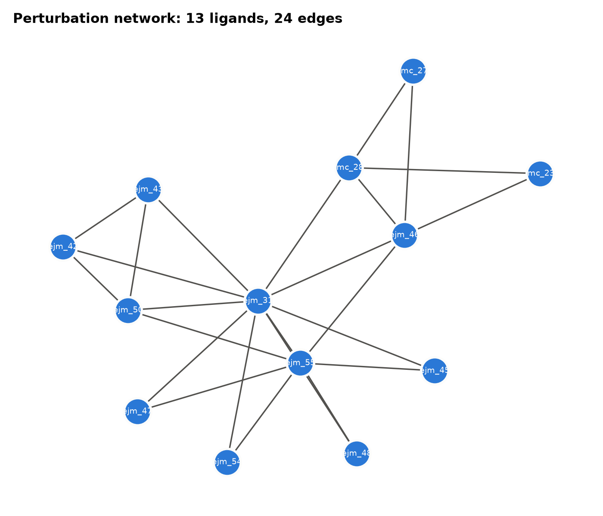

# How much does alchemical FEP add over MM/GBSA? A TYK2 follow-up

**Question:** on the same 13 TYK2 inhibitors as [Project 1](https://github.com/ranjan-kumar-biophys/tyk2-docking-md-mmgbsa) (docking vs MD + MM/GBSA), how much better does rigorous relative binding free energy (alchemical FEP) rank them?

**Answer:** _to be filled after the run._


## System

- TYK2 kinase domain (PDB 4GIH) and 13 ligands with measured Ki (2.5 nM – 0.84 µM), from the [OpenFF protein-ligand-benchmark](https://github.com/openforcefield/protein-ligand-benchmark) (MIT licence). These are the same inputs as Project 1.
- Experimental ΔG = RT ln Ki at 298.15 K.

## Methods

| Step | Script | What it does |
|---|---|---|
| 1 | `01_plan_network.py` | AM1-BCC charges (AmberTools, computed once). LOMAP atom mappings, minimal *redundant* network (union of 2 minimum spanning trees: 24 edges, 12 independent cycles), so every ligand is checked by cycle closure. One JSON per leg (complex + solvent): 48 transformations |
| 2 | `02_run_worker.py` + `hpc/run_pbs_gpu02.pbs` | One long-lived worker per GPU runs `openfe quickrun` in-process on each transformation (importing OpenFE once, not 48 times; a cold import took ~17 min on the cluster's network filesystem): OpenFE 1.13 hybrid-topology RBFE, OpenMM 8.4 (CUDA), 11 λ-windows with Hamiltonian replica exchange, 0.5 ns equilibration + 2 ns production per window, 4 fs time step (HMR), ff14SB / OpenFF 2.2.1 / TIP3P, 0.15 M NaCl |
| 3 | `03_analyse.py` | `openfe gather` → MLE ΔG per ligand and ΔΔG per edge; ΔG shifted to the experimental mean; Pearson r, Spearman ρ (bootstrap 95% CIs), MAE, RMSE, edge MAE, cycle-closure errors; 3-way comparison figure with Project 1 |

**Run length vs OpenFE defaults.** OpenFE's default is 3 repeats × (1 ns + 5 ns) per window. This run uses 1 repeat × (0.5 + 2 ns), about 7× cheaper, so uncertainties come from MBAR and cycle closure rather than independent repeats. All values are in `config.yaml`.

**Force-field note.** Project 1 used GAFF2 for ligands; OpenFE's default here is OpenFF 2.2.1 (Sage). Both use AM1-BCC charges and ff14SB for the protein.



## Results

_Filled in after the run._

## Reproduce

```bash
micromamba create -f environment.yml && micromamba activate tyk2-fep
python scripts/01_plan_network.py           # charges + network + 48 transformation JSONs
python scripts/01_plan_network.py --smoke   # optional: 1 tiny solvent leg, ~1-2 min on a laptop GPU
ls -d "$PWD"/work/network/transformations/*.json > tasks.txt
CUDA_VISIBLE_DEVICES=0 python scripts/02_run_worker.py tasks.txt   # start one per GPU; they share the list
python scripts/03_analyse.py
```
On a PBS cluster, `hpc/run_pbs_gpu02.pbs` runs all 48 legs over 2 GPUs and then the analysis. It starts with a 1–2 minute preflight that fails the job unless OpenMM actually selects **CUDA**, because OpenMM otherwise falls back to OpenCL/CPU silently. `hpc/submit_after.sh <job id>` submits it once an earlier job has left the queue (for queues with a per-user core limit).

**Match the CUDA runtime to the compute nodes' driver.** On a driver that supports CUDA 12.7, conda picked `cuda-version 12.9`, and OpenMM's CUDA platform then failed with `CUDA_ERROR_UNSUPPORTED_PTX_VERSION`; OpenCL still worked, so it would have run silently slow. Setting `CONDA_OVERRIDE_CUDA` alone did not prevent this. Pin it explicitly to a release at or below the driver's version, e.g. `mamba install -p ./env "cuda-version=12.6"`, then check with `python -m openmm.testInstallation` on a GPU node.

**Note:** `environment.yml` pins `openfe>=1.13`. Without the pin, the solver swaps in OpenFE 0.3 to satisfy the newest AmberTools, and the import fails.

## Contact

**Ranjan Kumar**, computational biophysicist (Physics PhD researcher, BITS Pilani).
I run this kind of study as a service: protein–ligand MD, MM/GBSA, FEP, enhanced sampling.
Email: ranjankumarbijarnia70@gmail.com · Baseline study: [docking vs MD + MM/GBSA](https://github.com/ranjan-kumar-biophys/tyk2-docking-md-mmgbsa)
